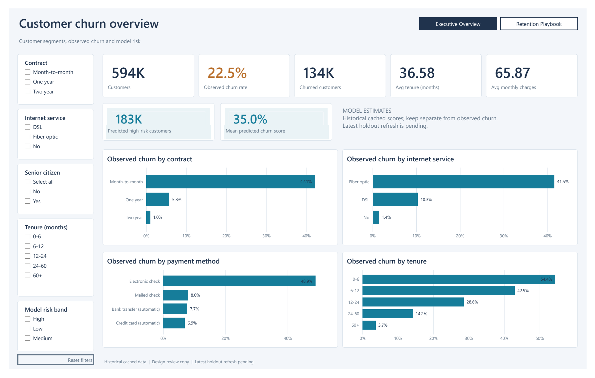
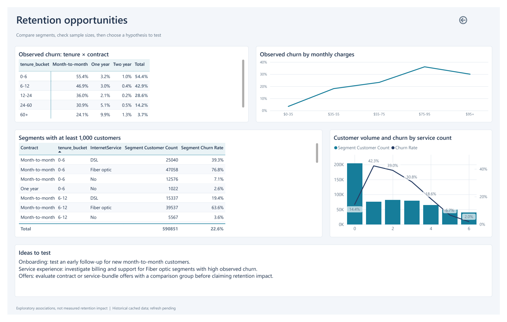
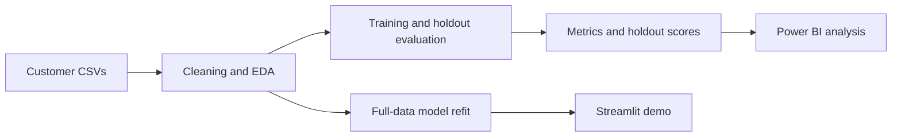

# Customer Churn Analysis & Prediction

A portfolio project exploring **which customer groups have higher observed churn** and how a classification model could help prioritize a retention review. It combines customer segmentation, model evaluation, a Power BI dashboard and a Streamlit scoring demo.

**Tools:** Python · pandas · scikit-learn · XGBoost · Power BI (Power Query / DAX) · Streamlit

**Data:** [Kaggle Playground S6E3](https://www.kaggle.com/competitions/playground-series-s6e3), with 594,194 labeled training rows and 254,655 unlabeled test rows. This is a static competition dataset used for portfolio analysis.

## Dashboard preview



[View both pages as PDF](power-bi/dashboard-design-preview.pdf) · [Power Query and DAX sources](power-bi/) · [Design notes](docs/dashboard-design.md)

*Current portfolio dashboard, using historical cached data. The latest Python holdout results are reported below; refreshing the dashboard with those scores remains pending. The interactive PBIX is kept locally because it embeds machine-specific source metadata; the public repository provides the PDF preview and M/DAX sources.*

<details>
<summary>View the retention opportunities page</summary>



</details>

## Key findings and suggested next steps

These descriptive findings use the same **118,839-customer holdout population**. They describe associations, not the effect of an intervention.

| Finding | Evidence | Suggested next step |
|---|---|---|
| Month-to-month customers had higher observed churn. | **42.1%** (n=59,853), compared with 5.8% for one-year and 0.9% for two-year contracts. | Test whether a suitable contract offer improves retention; do not assume contract length itself caused the difference. |
| Early-tenure customers were a priority group for investigation. | **54.6%** for tenure 0–6 months (n=17,343), versus 3.6% above 60 months. | Review onboarding and early support, then test a targeted follow-up. |
| Early-tenure, month-to-month Fiber optic customers stood out. | **76.9%** (n=9,546), versus 38.8% for DSL within the same contract and tenure group. | Investigate service and billing experience before choosing an offer; the dataset does not identify why customers left. |

Sources: [segment output](outputs/bi_segments.csv), [summary with counts](docs/analysis-summary.csv), and [analysis notes](docs/analysis-findings.md). No retention uplift or financial return has been measured.

## My contribution

This project began as a CDS4001 **group FYP**, where **my responsibility was model development**. The original project consisted of models and Jupyter notebooks.

For this portfolio version, I extended that starting point with a modular Python workflow, a Power BI dashboard and a Streamlit app. These were added after the FYP. The current version also improves data cleaning, consistent feature generation and model evaluation. The original group project and the later portfolio extensions are separate stages of the work.

## Approach

1. **Explore and clean:** inspect missing values, customer attributes and churn by segment. Validate categories, charges and tenure boundaries.
2. **Build and compare:** compare logistic regression, random forest and XGBoost using the same stratified 80/20 split. Fit preprocessing and feature selection on training data only.
3. **Evaluate and communicate:** report holdout performance, calibrate scores using folds inside the training partition, and examine the precision/recall trade-off at preset thresholds.
4. **Present:** explore segments in Power BI and score raw customer profiles in Streamlit. A separate model refit on all labeled rows serves the app.



## Model results

**475,355 training / 118,839 holdout rows**, stratified split, seed 42. Precision, recall and F1 below use a **0.5 classification threshold**. These are local holdout results, not scores on the unlabeled Kaggle test set.

| Model | ROC-AUC | Precision | Recall | F1 |
|---|---:|---:|---:|---:|
| Logistic regression | 0.911 | 0.549 | 0.880 | 0.676 |
| Random forest | 0.914 | 0.555 | 0.881 | 0.681 |
| XGBoost (calibrated) | 0.917 | 0.680 | 0.710 | 0.695 |

The XGBoost variants had similar ROC-AUC. Calibration improved probability accuracy in this evaluation; it did not improve ranking. A lower classification threshold finds more churned customers while increasing the number of customers selected for review.

Sources: [model comparison](outputs/model_comparison.csv), [threshold results](outputs/threshold_metrics.csv), [metrics and run details](outputs/metrics.json). See [evaluation method](docs/evaluation-method.md) for calibration, split roles and limitations.

<details>
<summary>Full results and reproducibility evidence</summary>

<!-- MODEL_RESULTS_START -->
## Reproducible model results

Run `20261027T175000746489Z-71d14d34`. **475,355 fit / 118,839 holdout** rows; stratified 80%/20%, seed 42. Every comparison uses this same full-data split. Classification metrics below use score ≥ 0.50.

Calibration: sigmoid on 3-fold out-of-fold predictions **inside the fit partition only**, then refit the base on that full fit partition (`ensemble=False`). Holdout labels never fit the feature statistics, selector, class weights or calibrator in this run. The XGBoost + FS + sigmoid recipe was fixed before this comparison; the holdout is not used to pick the winner or optimize thresholds. Historical Colab tuning records are unavailable, so this is not a claim of a never-before-inspected benchmark or proven optimal hyperparameters.

| Model | ROC-AUC | Precision | Recall | F1 | Brier ↓ | Log loss ↓ |
|---|---:|---:|---:|---:|---:|---:|
| logistic_regression | 0.910573 | 0.548766 | 0.879834 | 0.675939 | 0.127972 | 0.387056 |
| random_forest | 0.913623 | 0.554719 | 0.880880 | 0.680748 | 0.124960 | 0.378014 |
| xgboost_no_fs | 0.916539 | 0.560784 | 0.879909 | 0.685002 | 0.122827 | 0.372938 |
| xgboost_fs_raw | 0.916502 | 0.561108 | 0.879348 | 0.685074 | 0.122829 | 0.373051 |
| xgboost_fs_sigmoid | 0.916502 | 0.680242 | 0.709599 | 0.694611 | 0.096480 | 0.304128 |

Source: [model_comparison.csv](outputs/model_comparison.csv); exact values, parameters, environment and hashes: [metrics.json](outputs/metrics.json). RF is a capacity-limited baseline (150 trees, max_depth=12, min_samples_leaf=10); XGBoost no-FS/FS use the same frozen classifier settings. FS and calibration differences are diagnostic single-split results, not significance claims.

### Prespecified thresholds — calibrated holdout model

| Threshold | Selected | Workload | Precision | Recall | F1 |
|---|---:|---:|---:|---:|---:|
| 0.30 | 37,202 | 31.30% | 0.599699 | 0.833614 | 0.697569 |
| 0.50 | 27,918 | 23.49% | 0.680242 | 0.709599 | 0.694611 |
| 0.60 | 21,901 | 18.43% | 0.733528 | 0.600269 | 0.660242 |

Source: [threshold_metrics.csv](outputs/threshold_metrics.csv), including TP/FP/FN/TN. App/BI bands: Low <0.30, Medium [0.30, 0.60), High ≥0.60. These thresholds were configured before evaluation; no outreach cost, capacity optimum or retention ROI is established.

### Calibration on the same holdout

| Score | Brier ↓ | Log loss ↓ | ECE (10 equal-width bins) ↓ | Mean score | Observed churn |
|---|---:|---:|---:|---:|---:|
| xgboost_fs_raw | 0.122829 | 0.373051 | 0.124797 | 35.00% | 22.52% |
| xgboost_fs_sigmoid | 0.096480 | 0.304128 | 0.019398 | 22.60% | 22.52% |

Sources: [calibration_curve.csv](outputs/calibration_curve.csv) (per-bin sample counts and rates), [holdout_predictions.csv](outputs/holdout_predictions.csv) (ID, label, raw/calibrated score), [split_assignments.csv](outputs/split_assignments.csv) (outer partition and calibration folds). ECE depends on binning.


The separately refitted **final model uses all labeled rows**, with its own OOF calibration and full-data feature statistics. Its scores on those same rows are in-sample and do not produce the metrics above. The unlabeled Kaggle test CSV provides no local test AUC.
<!-- MODEL_RESULTS_END -->

</details>

## Run locally

Use **Python 3.11.15** in an activated virtual environment. On Windows, use a short environment path such as `%USERPROFILE%\venvs\churn`. Download the competition files and place `train.csv` and `test.csv` in `data/raw/`; they are not included in this repository.

From the project root:

```bash
python -m pip install -r requirements.lock.txt
python -m src.train --config config.yaml
python -m src.export_predictions --config config.yaml --scope holdout
python -m src.reporting --config config.yaml
streamlit run app/streamlit_app.py
```

For a different CSV location, edit the paths in `config.yaml`. [Setup and technical notes](docs/technical-notes.md) cover custom configuration, output files and verification commands.

## Scope and limitations

- This is a static competition-data analysis. It does not establish when a customer will churn or whether an offer will retain them.
- The Python workflow passed 23 regression tests and an isolated-environment dependency check. The Streamlit app was tested locally; the earlier online deployment has not been synchronized or verified for this version.
- The Power BI file opens and displays its historical report. Integrating the latest holdout scores is unfinished: a query preview raised `Formula.Firewall`, and the proposed staging-query solution still needs Desktop verification. [Remaining dashboard steps](docs/power-bi-final-validation.md).
- The project demonstrates Python analysis, modeling and BI. It does not include a SQL warehouse or production orchestration.

## Project files

| Location | Purpose |
|---|---|
| [notebooks/](notebooks/) | EDA, feature exploration and model evaluation |
| [src/](src/) | Cleaning, features, training, evaluation and exports |
| [app/](app/) | Local Streamlit scoring demo |
| [power-bi/](power-bi/) | Dashboard, Power Query and DAX sources |
| [outputs/](outputs/) | Generated evaluation and segment summaries |
| [docs/](docs/) | Detailed methods, setup evidence and dashboard follow-up |
