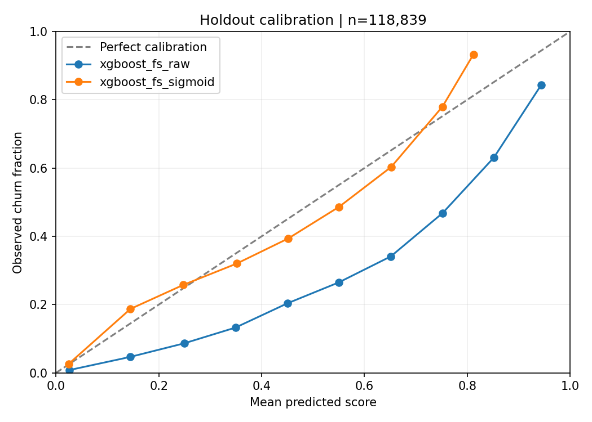

# Evaluation method and evidence

[Back to project overview](../README.md)

The README summary and findings refer to run `20261027T175000746489Z-71d14d34`. The original run files and metrics have not been changed by this documentation update.

## Populations and model roles

| Population / artifact | Role |
|---|---|
| 475,355 outer training rows | Fit feature statistics, preprocessing, selection and classifiers. Produce inner OOF scores for calibration. |
| 118,839 outer holdout rows | Evaluate the fixed recipes and preset thresholds; provide the default BI evaluation scores. |
| Evaluation artifact | Refit the base on outer training rows only. It is the source of the holdout metrics. |
| 594,194-row final refit | Separately calibrate and refit on all labeled rows for local app scoring. |
| Final-model diagnostic scores | Scores on the same full dataset used for final fitting; explicitly in-sample and not evaluation. |
| Unlabeled competition test | Inference only. No local test AUC is available without target labels. |

The outer split is stratified 80/20 with seed 42. Three-fold sigmoid calibration uses out-of-fold predictions inside the training partition, followed by a full-partition base refit (`ensemble=False`). Preprocessing, feature statistics, selection and class weighting are fitted within the applicable training folds.

## Model comparison

Logistic regression, a capacity-limited random forest, and XGBoost variants share the same outer split. No-FS and FS XGBoost variants use the same fixed classifier settings. The current calibrated recipe was fixed before this comparison; this run did not select a winner or tune thresholds using the holdout.

The original Colab tuning history is unavailable, so the holdout should not be described as a never-before-inspected benchmark. Differences from one split are descriptive and do not demonstrate statistical significance or optimal hyperparameters.

- [Complete model comparison](../outputs/model_comparison.csv)
- [Exact parameters and metrics](../outputs/metrics.json)

## Thresholds and calibration

Classification metrics in the README use score ≥0.5. App/BI risk bands are Low <0.3, Medium [0.3,0.6), High ≥0.6. These are preset thresholds, not cost-optimized outreach policies. In particular, recall at 0.5 must not be presented as recall for the ≥0.6 high-risk band.

The [threshold table](../outputs/threshold_metrics.csv) records precision, recall, F1, selected population and confusion-matrix counts. The [calibration table](../outputs/calibration_curve.csv) records counts and observed rates per bin; ECE depends on binning. Lower Brier score and log loss indicate improved probability accuracy on this holdout, not proven future performance.



## Reproduce or check

```bash
python -m unittest discover -s tests -v
python -m src.reporting --config config.yaml --check
```

The reporting command checks the README's expandable, generated full-results block and the saved run's source/output identities. The short headline table and business findings are snapshots of the run identified above; update them from the linked CSVs when publishing results from a new run. Every major README model metric has a method and output source.

Per-row scores and split assignments are generated locally and ignored by Git. They must be regenerated from the competition CSVs before running the complete local evidence check. Aggregate comparison and segment CSVs are included as reviewable evidence.
